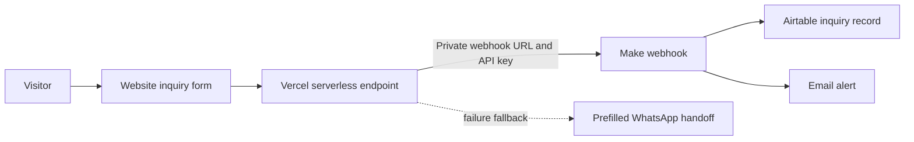
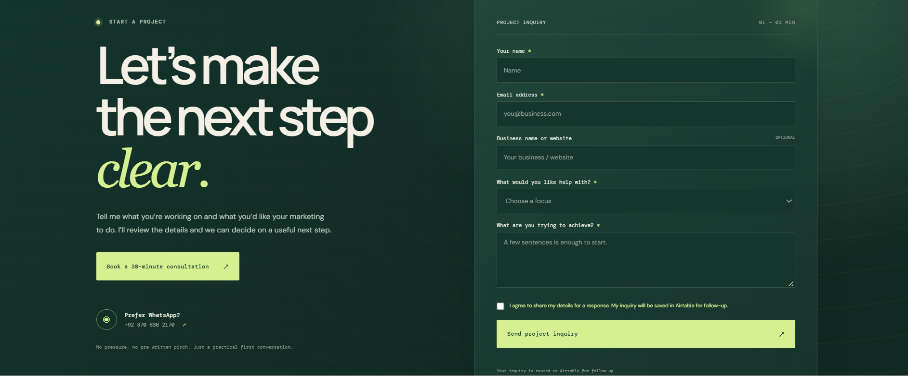
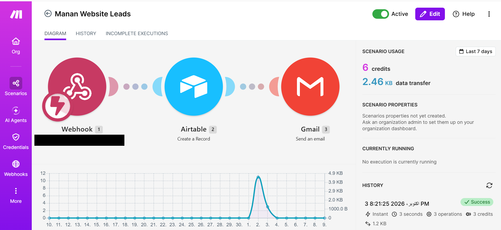
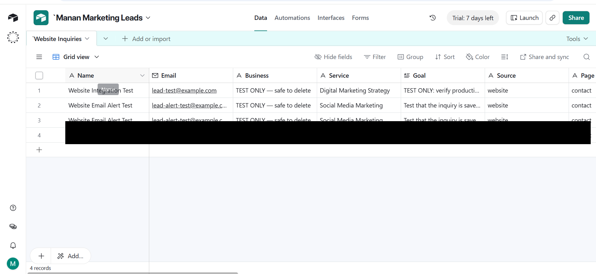
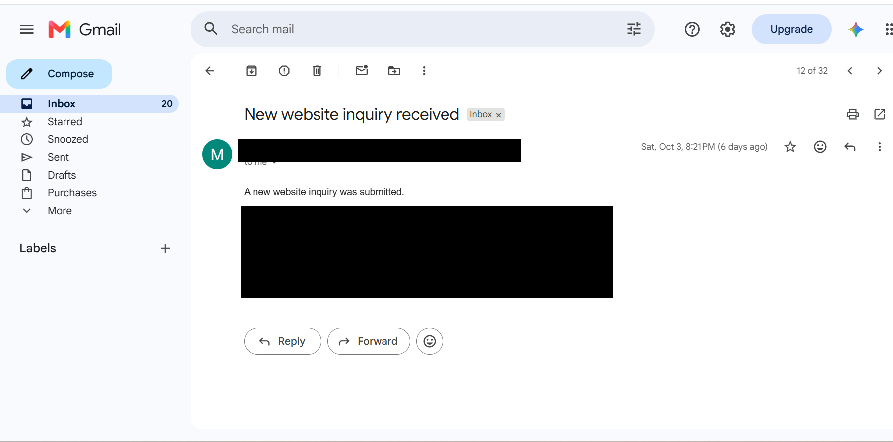

# DigiRacket Website Lead Intake Automation

A real website inquiry workflow connecting a contact form to Make, Airtable, and email notifications.

**Project category:** business workflow automation. This is not an AI chatbot, voice receptionist, or AI agent.

## Live demo

Visit the [DigiRacket project inquiry form](https://digiracket.vercel.app/contact) to see the visitor-facing form and its Calendly and WhatsApp options.

## Project overview

The DigiRacket contact form collects an inquiry and the visitor's consent to be contacted. A Vercel serverless endpoint validates the request and sends the data to a Make webhook. Make creates an Airtable record and sends an email alert so the inquiry can be reviewed and followed up.

If the automated endpoint is unavailable, the website offers a prefilled WhatsApp handoff. That fallback opens a conversation for a person to handle; it is not an automated WhatsApp assistant.

## The workflow



1. The visitor submits required project details and consent.
2. The browser sends a same-origin `POST /api/lead` request.
3. The Vercel function checks the method, request size, required values, email format, consent, and hidden honeypot field; it trims and limits text fields.
4. The function adds a server timestamp and sends JSON to Make using the `x-make-apikey` header.
5. Make creates a record in Airtable and sends a Gmail notification.
6. If the route fails, the form provides a human WhatsApp handoff.

## Tech stack

| Layer | Tool | Role |
| --- | --- | --- |
| Website | HTML, CSS, JavaScript | Collects and submits inquiries |
| Server-side endpoint | Vercel Functions | Validates the request and keeps webhook credentials out of browser code |
| Workflow automation | Make | Receives and routes lead data |
| Lead database | Airtable | Stores inquiries for review and follow-up |
| Notification | Gmail | Sends an email alert when an inquiry arrives |
| Version control | GitHub | Holds the website source and this sanitized project case study |

## Screenshots

These captures show the website form and the connected workflow. Personal inquiry details and the partial Make webhook address have been covered. The Make scenario and Airtable base still display their original names from before the DigiRacket rebrand.

### Website inquiry form



### Make workflow



### Airtable inquiry table

The real inquiry row is fully covered; the visible test rows are explicitly marked as test data.



### Email alert

The lead and account details are covered. This screenshot demonstrates the notification email format and delivery in Gmail.



## Repository contents

```text
digiracket-lead-intake-automation/
├── api/
│   └── lead.js                     # Sanitized snapshot of the production endpoint
├── docs/
│   ├── architecture.md             # Data fields, routing, and failure behavior
│   └── project-case-study.md       # Problem, solution, decisions, and limits
├── examples/
│   └── sample-lead.json            # Fictional sample payload
├── Screenshots/
│   ├── 01-website-contact-form.png # Blank live form
│   ├── 02-make-workflow.png        # Make → Airtable → Gmail scenario
│   ├── 03-airtable-test-record.png # Test data; real lead row redacted
│   ├── 04-email-alert-test.png     # Alert with identifying details redacted
│   └── README.md                   # Capture and privacy notes
├── .env.example                    # Variable names only
├── .gitignore
└── README.md
```

## Configuration and privacy

The production Vercel project reads `MAKE_WEBHOOK_URL` and `MAKE_WEBHOOK_API_KEY` as server-side environment variables. The key is passed to Make in the `x-make-apikey` header. This repository contains the variable names only—not their values, Make scenario exports, Airtable account identifiers, inbox address, or real lead records.

Businesses I have worked with have not approved public use of their names, account details, or campaign materials. This project therefore documents DigiRacket's own inquiry workflow and uses only fictional example data. The screenshot gallery must not reveal personal lead details, email addresses, webhook URLs, API keys, browser profile details, or private account information.

## Verification and limits

The end-to-end setup was previously checked: an inquiry reached Airtable and the email alert was confirmed. This repository does not claim lead volume, conversion rate, response-time improvements, revenue, or time saved.

- The endpoint uses a basic honeypot; it does not currently implement dedicated rate limiting or CAPTCHA.
- The WhatsApp fallback is a human handoff, not a bot.
- Make, Airtable, and Gmail are configured in their own accounts and are not controlled by this repository.
- The reference [`api/lead.js`](api/lead.js) is a snapshot. The live production source remains in [the DigiRacket website repository](https://github.com/manankhan53/digiracket), which is connected to Vercel.

For the detailed field map and failure behavior, see [`docs/architecture.md`](docs/architecture.md). For the project rationale, see [`docs/project-case-study.md`](docs/project-case-study.md).
