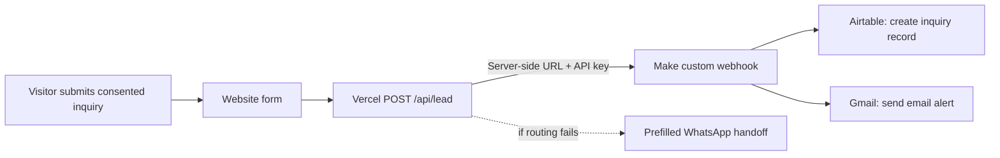

# DigiRacket Website Lead Intake Automation

A documented, working lead-intake workflow for the DigiRacket website. It routes a visitor's consented project inquiry through a server-side endpoint to Make, then creates an Airtable record and sends an email alert.

> **Project type:** business workflow automation. This is not an AI chatbot, voice receptionist, or AI agent.

## What it does

1. A visitor submits the project inquiry form and agrees to be contacted.
2. The browser sends the form to the website's same-origin `POST /api/lead` endpoint.
3. A Vercel serverless function validates required fields and consent, limits text lengths, ignores submissions that fill the hidden honeypot, adds a server timestamp, and forwards the payload to Make.
4. Make creates a record in Airtable's `Website Inquiries` table.
5. Make sends an email notification with the inquiry details.
6. If the automated route is unavailable, the website offers a prefilled WhatsApp handoff.

## Implementation and live system

- **Website:** [DigiRacket](https://digiracket.vercel.app/contact)
- **Production website source:** [manankhan53/digiracket](https://github.com/manankhan53/digiracket)
- **Automation platform:** Make
- **Lead destination:** Airtable
- **Notification:** Gmail
- **Reference endpoint:** [`api/lead.js`](api/lead.js)
- **Field example:** [`examples/sample-lead.json`](examples/sample-lead.json)
- **System notes:** [`docs/architecture.md`](docs/architecture.md)

The reference endpoint is a snapshot of the production Vercel function. Production changes should be made in the DigiRacket website repository, which is connected to Vercel for deployment. This repository documents and showcases the project; it does not independently control the live Make scenario, Airtable base, Gmail connection, or website deployment.

## Configuration

The production Vercel project reads two server-only environment variables:

- `MAKE_WEBHOOK_URL`
- `MAKE_WEBHOOK_API_KEY`

The API key is sent to Make in the `x-make-apikey` HTTP header. The actual values, Make scenario export, Airtable base identifiers, inbox address, and real lead data do not belong in this public repository. See [`.env.example`](.env.example) for names only.

The Make route is configured as:

**Custom webhook → Airtable: Create a Record → Gmail: Send an email**

The existing end-to-end setup was manually exercised. No lead volume, response-time, conversion, or revenue claim is made here.

## Data handled

The form can send a person's name, email, business, requested service, project goal, consent, page/referrer information, UTM campaign fields, and submission time. The website function validates and forwards the payload. Airtable stores the inquiry for follow-up, and Make emails an alert.

Only publish synthetic example data. Do not commit production leads, screenshots containing personal details, webhook URLs, API keys, or Make exports that may contain credentials or account identifiers.

## Important limits

- The automated route has a basic hidden-field honeypot, but this implementation does not include dedicated rate limiting or CAPTCHA. Add appropriate abuse controls before relying on it for high-volume traffic.
- The WhatsApp fallback is a handoff to a person; it is not an automated WhatsApp chatbot.
- Make, Airtable, and Gmail connections are managed in their respective accounts. This repository does not contain those credentials or configuration exports.
- Keep the privacy notice and consent language aligned with the data actually collected and how leads are used.

## Next development ideas

- Add rate limiting and stronger spam controls.
- Add operational monitoring for failed webhook deliveries.
- Document lead retention and access practices.
- Add a human-reviewed status and follow-up SLA in Airtable.
- Build future lead-generation, AI voice receptionist, or customer-support systems as separate projects with their own scope, safeguards, and verified results.

## Accuracy

This project is presented as a real website inquiry automation. It does not claim AI functionality or invented client outcomes, lead counts, conversion rates, revenue, or time savings.
